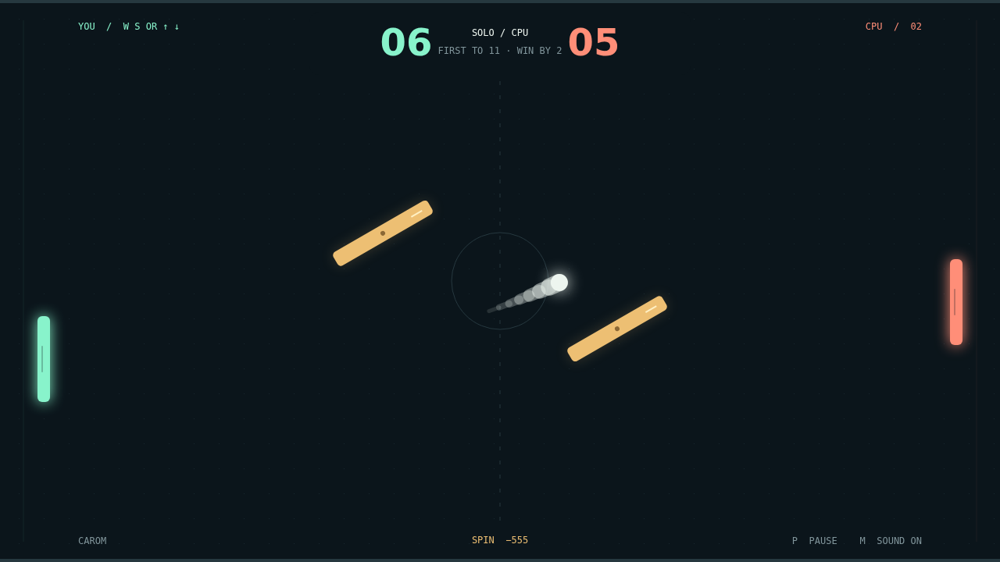

# Every angle is an opening.

Carom is a paddle duel with a twist in every rally. Take the mint paddle against the CPU, or share a keyboard for a local contest. The first serve gives you a moment to get into position. After that, every return makes the ball a little faster.

A moving paddle puts spin on the ball. Slide through contact and watch a straight shot bend across the court; catch it near the edge and send it off at a sharper angle. A good return is as much about your movement as your position.

Two amber obstacles sway and rotate between you and the other player. Bank off a tilted face, squeeze a shot through the opening, or let a curved flight take the long way around. The same shot can find a different route on the very next rally.

First to eleven wins, but you need a two-point lead. At match point, the court feels a little smaller and every opening matters. Find your angle, make the return, and play again.

